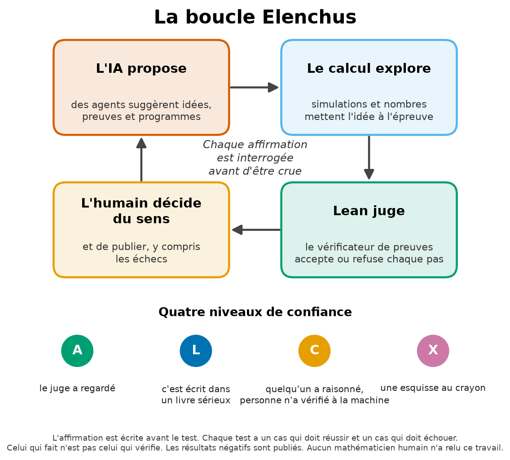

# Elenchus en dix minutes

[English version](elenchus-in-10-minutes.md)

*Pour les lecteurs qui ne sont pas scientifiques. Sans formules.*

## La question

Les agents d'IA écrivent vite et bien. Ils écrivent aussi des choses fausses, avec la même assurance. Comment savoir alors si une machine dit vrai ?

On ne la croit pas sur parole : on l'interroge. En grec ancien, l'*elenchos* est l'examen par questions que pratiquait Socrate. Il posait des questions jusqu'à trouver l'endroit où une affirmation se contredisait. Ce qui résistait à l'examen méritait d'être cru, au moins pour un temps.

Elenchus fait de cette habitude une technique. À la place du philosophe, il y a des **règles** que chaque résultat doit franchir avant d'être publié, et des **programmes** qui posent une partie des questions.

## La boucle

1. **L'IA propose** une idée, une preuve ou un programme.
2. **Le calcul explore.** Des calculs sur ordinateur mettent l'idée à l'épreuve avant toute tentative de preuve.
3. **Le vérificateur de preuves juge.** Lean est un langage où l'on écrit les preuves avec tant de détails qu'un ordinateur peut les contrôler. En son centre se trouve un petit programme, le *noyau*, dont le seul travail est de vérifier chaque pas. Il ne peut pas inventer une preuve. Il peut seulement dire « chaque pas est correct » ou « quelque chose ne va pas ici ».
4. **L'humain décide du sens**, et de ce qui mérite d'être publié.

## Les sept règles

1. **Écrire l'affirmation avant le test**, avec ce qui la ferait tomber.
2. **Donner un niveau à chaque affirmation** : A, L, C ou X.
3. **Faire un test qui doit échouer et un test qui doit réussir**, pour montrer que le test fonctionne.
4. **Celui qui fait n'est pas celui qui vérifie.**
5. **Publier les résultats négatifs** avec le même soin que les autres.
6. **Confier la logique à un juge impartial**, le noyau de Lean, et savoir comment on peut le tromper.
7. **Tenir un registre** de chaque affirmation, avec son niveau et sa preuve, et le laisser dire « non » quand quelque chose manque.

## Les quatre niveaux

| Niveau | En mots de tous les jours |
|---|---|
| **A** | **« Le juge a regardé. »** Le noyau de Lean a contrôlé chaque pas, la preuve n'utilise que les trois règles de base habituelles, un second programme a relu toute la preuve (la *relecture*, ou *replay*), et une recherche n'a trouvé aucune astuce pour contourner le juge. |
| **L** | **« C'est écrit dans un livre sérieux. »** Un résultat publié, lu et cité précisément. |
| **C** | **« Quelqu'un a raisonné, personne n'a vérifié à la machine. »** Un raisonnement écrit. Ici, il a presque toujours été écrit par un agent d'IA et relu par un autre. |
| **X** | **« Une esquisse au crayon. »** Un calcul avec des nombres décimaux arrondis. Il montre la voie, et il peut montrer qu'une idée est fausse. Il ne prouve jamais rien. |

Une affirmation qui mélange plusieurs niveaux **ne vaut que ce que vaut son maillon le plus faible**.

## Trois images de la vie courante

**1. Le procès.** L'agent qui a produit un résultat est la défense : il plaide que le résultat est vrai. L'agent qui l'audite est l'accusation : il cherche la faille. Le noyau de Lean est le juge, et ce juge ne lit que les pièces écrites, jamais les plaidoiries. Les beaux discours ne l'impressionnent pas. Mais le juge ne décide pas si le procès portait sur la bonne question : cela revient à un humain. *Où l'image s'arrête :* un vrai juge pèse des témoignages ; le noyau ne pèse rien, il vérifie.

**2. Le détecteur de fumée.** Un détecteur qui ne sonne jamais rassure beaucoup, jusqu'au jour de l'incendie. C'est pourquoi on appuie sur son bouton de test. Chaque test de ce travail a deux contrôles. L'un est un cas où la réponse doit être « oui ». L'autre est un cas où elle doit être « non » : par exemple une preuve volontairement laissée avec un trou, que le juge doit refuser. *Où l'image s'arrête :* un détecteur qui sonne pendant le test peut encore rater un autre genre de feu. Un contrôle montre que le test marche sur ce cas, pas sur tous.

**3. La recette goûtée par quelqu'un d'autre.** Le cuisinier qui goûte sa propre sauce la trouve toujours bonne : il sait ce qu'il voulait y mettre. On la fait donc goûter par quelqu'un d'autre. Ici, un second agent d'IA, lancé séparément, reçoit les fichiers, les recompile, refait les calculs avec ses propres programmes et rédige un verdict. Les corrections qu'il demande sont appliquées et consignées. *Où l'image s'arrête :* le goûteur est lui aussi une IA, souvent du même fabricant. Il ne connaît pas la recette, mais il a peut-être les mêmes papilles. **Un audit par une IA n'est pas une relecture humaine par des pairs.**

## Comment on peut tromper le juge, et comment on s'en aperçoit

- **La copie rendue avec une page « à finir ».** En Lean, on peut écrire `sorry` à la place d'une partie de preuve, et le fichier se termine quand même sans erreur. *Parade :* ne jamais se fier à « terminé sans erreur ». Demander au juge sur quoi repose chaque théorème : un trou y apparaît.
- **La règle glissée en douce.** On peut déclarer un *axiome*, une règle admise sans preuve. Un axiome faux permet de tout prouver, même 1 = 2. *Parade :* chaque théorème ne peut reposer que sur les trois règles de base habituelles.
- **La page qui n'est jamais passée devant le juge.** Une option réservée aux développeurs permet d'enregistrer une déclaration sans la faire vérifier. La liste habituelle des axiomes ne la voit pas. *Parade :* la relecture, où un second programme relit chaque déclaration enregistrée et la soumet de nouveau au noyau. Une contrefaçon plantée exprès a été rejetée par la relecture, comme il se doit.
- **La bonne preuve de la mauvaise question.** Le juge vérifie que la preuve démontre l'énoncé écrit. Il ne vérifie pas que l'énoncé dit ce que nous racontons qu'il dit. Seul un lecteur humain attentif peut le vérifier. **Pour les résultats présentés ici, cette lecture humaine n'a pas encore été faite**, et chaque registre le dit.

## Un exemple : une idée qui descend, puis remonte, les niveaux

**L'idée.** On sait que le rangement en triangles est le plus économe en énergie pour des points qui se repoussent, quand ces points sont *au repos*. Mais dans le monde quantique, les points ne sont jamais tout à fait immobiles : même au zéro absolu ils frissonnent un peu, et ce frisson a une énergie, l'*énergie de point zéro*. L'idée naturelle, baptisée QU-1, était : « le triangle minimise aussi l'énergie de point zéro ». Elle a été **préenregistrée**, écrite avant tout test, avec une chance de survie estimée à 0,6.

**L'esquisse au crayon (X).** Avant d'essayer de la prouver, on l'a testée par le calcul. Deux formules, programmées de quatre façons, puis une cinquième fois par l'auditeur, ont calculé l'énergie de point zéro de nombreux rangements. Pour 8 des 12 forces testées, un autre rangement stable avait une énergie de point zéro plus basse que le triangle. QU-1 était réfutée, mais seulement « au crayon » : des nombres décimaux, si bien qu'ils s'accordent, ne prouvent rien. ([doi:10.5281/zenodo.23653833](https://doi.org/10.5281/zenodo.23653833))

**Le certificat (A pour la logique, C pour l'ensemble).** Pour l'une des forces, en forme de cloche, on voulait une preuve. On a déformé très légèrement le rangement en triangles, par un petit *cisaillement*, comme on pousse le haut d'un paquet de cartes. Un calcul rigoureux par encadrements garantis a montré que l'énergie de point zéro *diminue* pour tout cisaillement assez petit. Le triangle n'est donc même pas un minimum local pour cette force. Le calcul a découpé le problème en 206 468 cellules, et aucune n'a échoué. Le noyau de Lean a vérifié la logique de l'argument et l'arithmétique exacte. ([doi:10.5281/zenodo.23655392](https://doi.org/10.5281/zenodo.23655392))

Mais les encadrements eux-mêmes ont été calculés par un programme extérieur au noyau, et certaines étapes de liaison sont des raisonnements écrits par des agents d'IA, qu'aucune machine ni aucun humain n'a vérifiés. L'article écrit donc honnêtement : le résultat principal est de niveau C dans son ensemble ; seules sa logique et son arithmétique sont de niveau A. C'est la règle du maillon le plus faible.

**Les contrôles.** La même méthode, appliquée à une cloche plus étroite pour laquelle les calculs au crayon ne prévoyaient aucune baisse, n'a pas certifié de baisse, comme il se doit. Des preuves à trous volontaires, un axiome planté et un certificat falsifié ont tous été refusés par le juge.

**L'audit et le registre.** Un agent distinct a refait les calculs. Le registre répond toujours « non », car aucune personne n'a encore certifié que les énoncés Lean disent ce que disent leurs descriptions.

**Ce que montre l'exemple.** En quelques semaines, la même idée a été une intuition, une hypothèse préenregistrée, une réfutation au crayon, puis un certificat mixte dont chaque pièce porte son niveau. À aucun moment on n'a écrit « démontré » pour ce qui ne l'était pas. C'est cela, Elenchus : ne pas toujours avoir raison, mais savoir à chaque instant *jusqu'où* on a raison, et le dire.

## Ce que la méthode ne fait pas

Elenchus n'est pas une garantie. La méthode ne remplace pas la relecture humaine. Elle ne dit pas si une question vaut la peine d'être posée. Elle n'empêche pas les erreurs : elle les rend plus faciles à trouver. Et elle ne s'applique pas toute seule : la rechute du 19 octobre 2026 est survenue un mois *après* la mise par écrit de la méthode ([nos erreurs](what-we-got-wrong.fr.md)).

Versions longues : le chapitre 1 du *Journal des découvertes* ([français](../books/discovery-journal-2026-fr.pdf)) et, pour les spécialistes, [`elenchus/METHODOLOGY.md`](../elenchus/METHODOLOGY.md) (en anglais).
