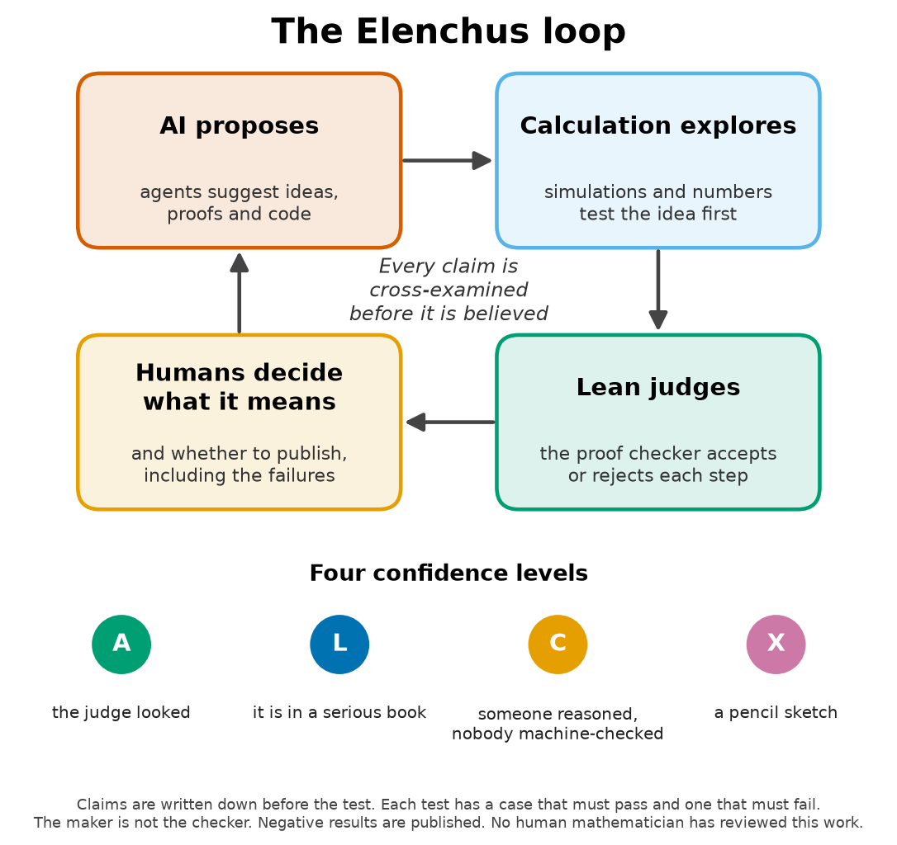

# Elenchus in ten minutes

[Version française](elenchus-in-10-minutes.fr.md)

*For readers who are not scientists. No formulas.*

## The question

AI agents write quickly and well. They also write false things, with the same confidence. So how can you tell whether a machine is telling the truth?

You do not take its word for it. You question it. In ancient Greek, *elenchos* is the kind of questioning Socrates practised: he asked questions until he found where a claim contradicted itself. Whatever survived the questioning deserved to be believed, at least for a while.

Elenchus turns that habit into engineering. Instead of a philosopher, there are **rules** that every result must get through before it is published, and **programs** that ask some of the questions.

## The loop

1. **AI proposes** an idea, a proof or a program.
2. **Calculation explores.** Computer calculations test the idea before anyone tries to prove it.
3. **The proof checker judges.** Lean is a language in which proofs are written in so much detail that a computer can check them. At its centre sits a small program, the *kernel*, whose only job is to check each step. It cannot invent a proof. It can only say "every step is correct" or "something is wrong here".
4. **Humans decide what it means**, and whether it is worth publishing.

## The seven rules

1. **Write the claim down before the test**, together with what would prove it wrong.
2. **Give every claim a level**: A, L, C or X.
3. **Run one test that must fail and one that must pass**, to show that the test works.
4. **The one who makes is not the one who checks.**
5. **Publish the negative results** with the same care as the others.
6. **Hand the logic to an impartial judge**, the Lean kernel, and know how it can be fooled.
7. **Keep a ledger** of every claim, with its level and its evidence, and let the ledger say "no" when something is missing.

## The four levels

| Level | In everyday words |
|---|---|
| **A** | **"The judge looked."** The Lean kernel checked every step, the proof uses only the three standard basic rules, a second program re-read the whole proof (the *replay*), and a search found no trick for getting around the judge. |
| **L** | **"It is in a serious book."** A published result, read and cited precisely. |
| **C** | **"Someone reasoned, nobody machine-checked."** A written argument. Here it was almost always written by one AI agent and read by another. |
| **X** | **"A pencil sketch."** A calculation with rounded decimal numbers. It points the way, and it can show that an idea is wrong. It never proves anything. |

A claim that mixes levels is **only as strong as its weakest link**.

## Three pictures from everyday life

**1. The trial.** The agent that produced a result is the defence: it argues that the result is true. The agent that audits it is the prosecution: it looks for the flaw. The Lean kernel is the judge, and this judge reads only the written evidence, never the speeches. Fine words do not impress it. But the judge does not decide whether the trial was about the right question. That is left to a human. *Where the picture stops:* a real judge weighs testimony; the kernel weighs nothing, it checks.

**2. The smoke detector.** A detector that never goes off is very reassuring, right up to the day of the fire. That is why you press its test button. Every test in this work has two controls. One is a case where the answer must be "yes". The other is a case where it must be "no": for example, a proof deliberately left with a hole in it, which the judge must refuse. *Where the picture stops:* a detector that sounds during the test can still miss a different kind of fire. A control shows that the test works on that case, not on every case.

**3. The recipe tasted by someone else.** The cook who tastes his own sauce always likes it: he knows what he meant to put in it. So someone else tastes it. Here a second AI agent, started separately, receives the files, recompiles them, redoes the calculations with its own programs and writes a verdict. The corrections it asks for are applied and recorded. *Where the picture stops:* the taster is also an AI, often from the same maker. It does not know the recipe, but it may have the same taste buds. **An AI audit is not human peer review.**

## How the judge can be fooled, and how we notice

- **The homework with a page "to be finished".** In Lean you can write `sorry` in place of part of a proof, and the file still finishes without an error. *Remedy:* never trust "finished without error". Ask the judge what each theorem rests on: a hole shows up there.
- **A rule slipped in quietly.** You can declare an *axiom*, a rule accepted without proof. A false one lets you prove anything, even 1 = 2. *Remedy:* every theorem may rest only on the three standard basic rules.
- **A page that never went before the judge.** A developer option lets a declaration be stored without being checked. The usual axiom list does not see it. *Remedy:* the replay, in which a second program re-reads every stored declaration and submits it to the kernel again. A planted forgery was rejected by the replay, as it should be.
- **The right proof of the wrong question.** The judge checks that the proof proves the written statement. It does not check that the statement says what we tell people it says. Only a careful human reader can check that. **For the results here, that human reading has not been done yet**, and every ledger says so.

## A worked example: an idea that went down, then up, the levels

**The idea.** Triangles are known to be the lowest-energy arrangement of points that repel each other when the points are *at rest*. But in the quantum world points are never completely still: even at absolute zero they tremble a little, and this trembling has an energy, the *zero-point energy*. The natural idea, called QU-1, was: "triangles also minimise the zero-point energy". It was **preregistered**, written down before any test, with an estimated chance of survival of 0.6.

**The pencil sketch (X).** Before trying to prove it, we tested it by calculation. Two formulas, programmed in four ways and a fifth time by the auditor, computed the zero-point energy of many arrangements. For 8 of the 12 forces tested, another stable arrangement had a lower zero-point energy than the triangle. QU-1 was refuted, but only "in pencil": decimal numbers, however well they agree, prove nothing. ([doi:10.5281/zenodo.23653833](https://doi.org/10.5281/zenodo.23653833))

**The certificate (A for the logic, C for the whole).** For one of the forces, a bell-shaped one, we wanted a proof. The triangle arrangement was deformed very slightly, by a small *shear*, the way you push the top of a stack of cards. A rigorous calculation with guaranteed enclosures showed that the zero-point energy *decreases* for every small enough shear. The triangle is therefore not even a local minimum for that force. The calculation split the problem into 206,468 cells, and none of them failed. The Lean kernel checked the logic of the argument and the exact arithmetic. ([doi:10.5281/zenodo.23655392](https://doi.org/10.5281/zenodo.23655392))

But the enclosures themselves were computed by a program outside the kernel, and some linking steps are reasoning written by AI agents that no machine or human has checked. So the paper says, honestly: the main result is level C as a whole; only its logic and arithmetic are level A. That is the weakest-link rule.

**The controls.** The same method, applied to a narrower bell for which the pencil calculations predicted no decrease, did not certify a decrease, as it should not. Proofs with deliberate holes, a planted axiom and a falsified certificate were all refused by the judge.

**The audit and the ledger.** A separate agent redid the calculations. The ledger still answers "no", because no person has yet certified that the Lean statements say what their descriptions say.

**What the example shows.** Within a few weeks, the same idea was an intuition, a preregistered hypothesis, a refutation in pencil, and a mixed certificate in which every piece carries its level. At no point was "proved" written for something that was not. That is Elenchus: not always being right, but knowing at every moment *how far* you are right, and saying so.

## What the method does not do

Elenchus is not a guarantee. It does not replace human review. It does not say whether a question is worth asking. It does not prevent mistakes; it makes them easier to find. And it does not apply itself: the relapse of 19 October 2026 came one month *after* the method was written down ([what we got wrong](what-we-got-wrong.md)).

Longer versions: chapter 1 of the *Discovery Journal* ([English](../books/discovery-journal-2026-en.pdf)) and, for specialists, [`elenchus/METHODOLOGY.md`](../elenchus/METHODOLOGY.md).
